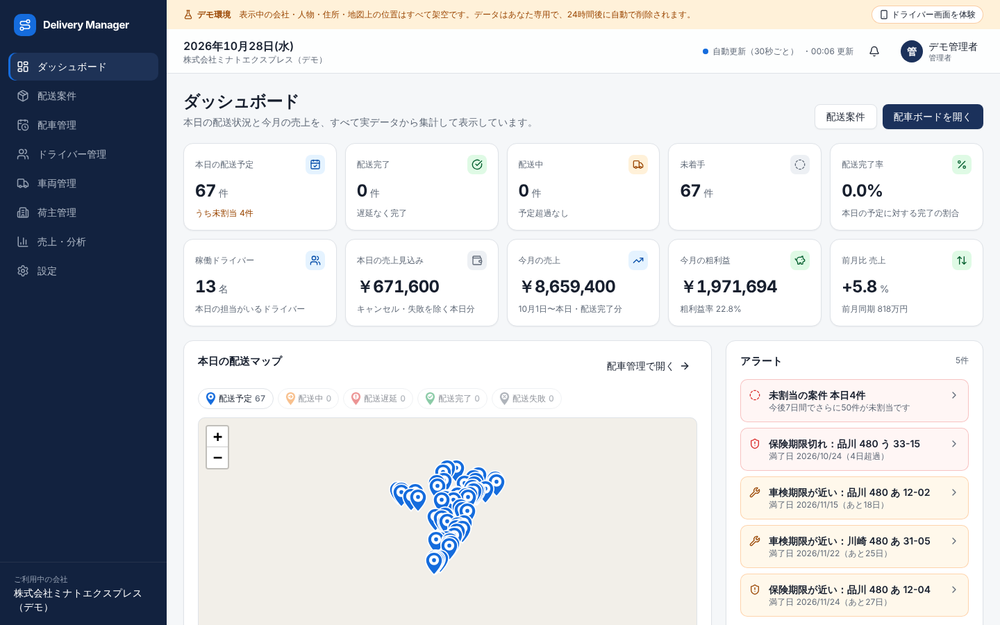
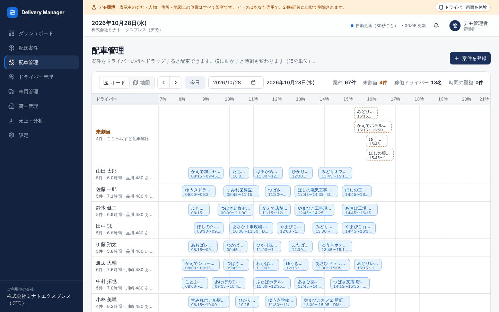
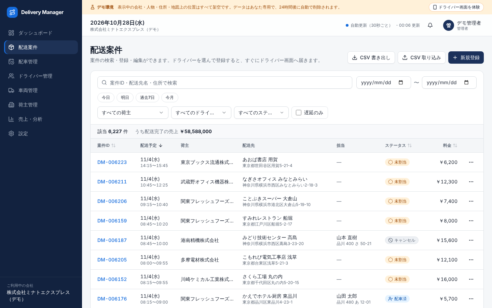
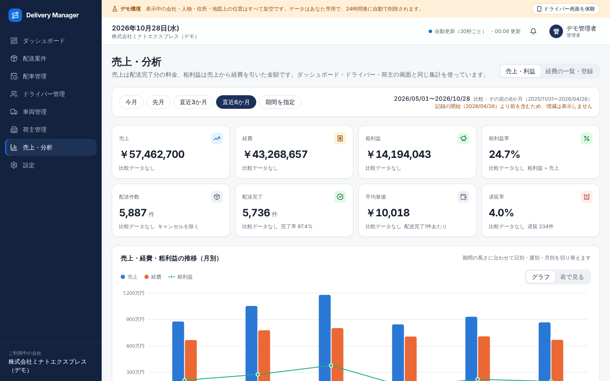
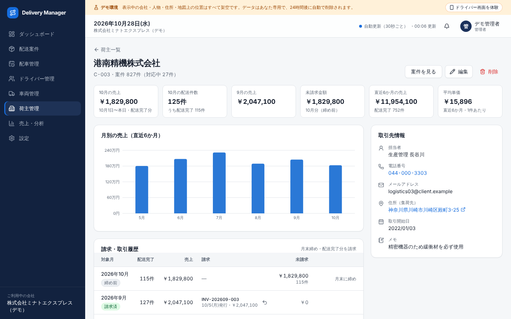
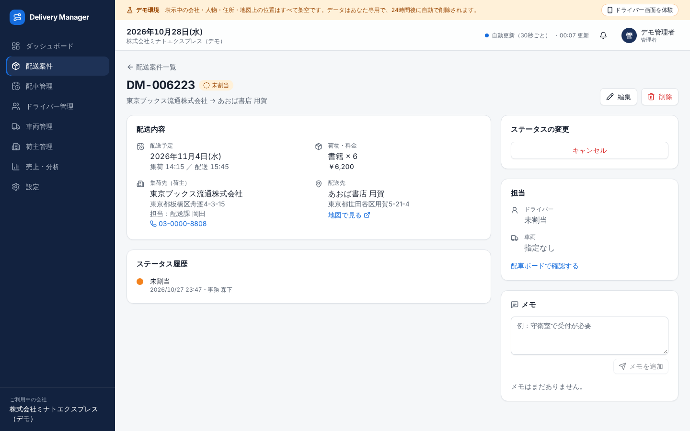
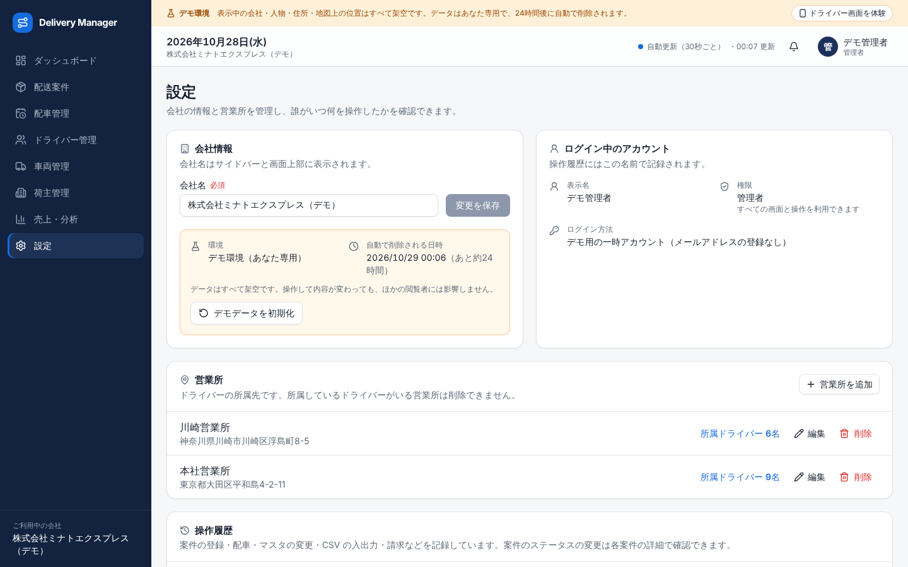
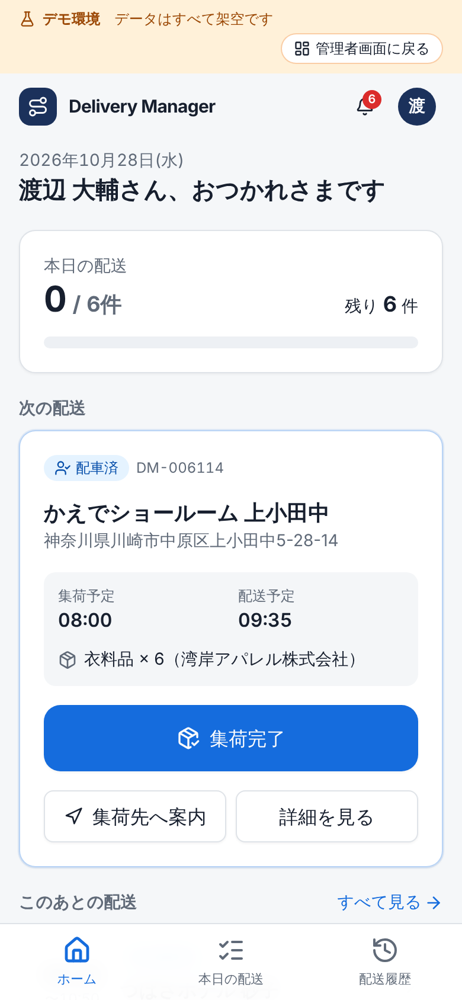
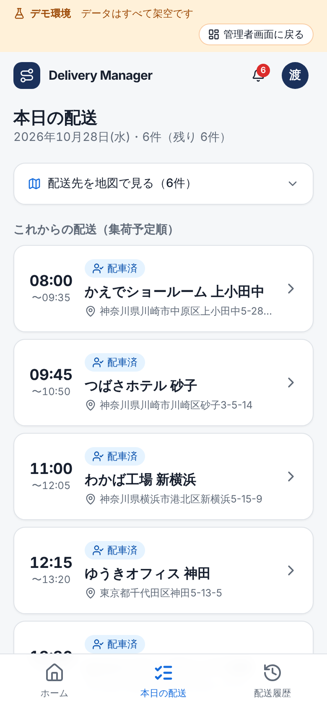
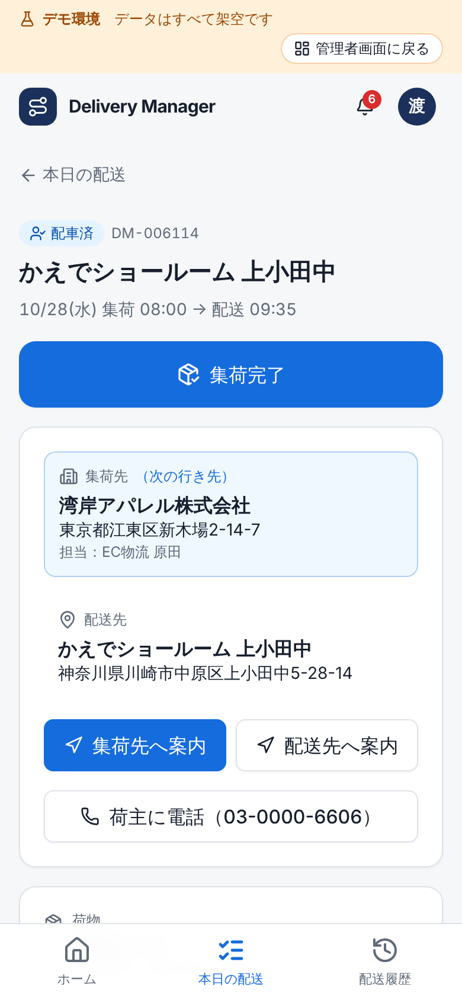

# Delivery Manager

**配送業務のすべてを、ひとつの画面で。**

従業員5〜30名の配送会社向けの統合業務管理システムです。Excel・紙・ホワイトボードで管理されがちな配送案件・配車・ドライバー・車両・荷主・売上を一元管理し、ドライバーはスマートフォンから配送ステータスを更新できます。



- 「管理者として体験」「ドライバーとして体験」を押すと、**訪問者ごとに専用のデモ会社**（架空の配送会社・案件 約6,000件）がその場で作られます。登録は不要です
- 表示している数字はすべて DB の実データから集計しています（固定値の表示はありません）
- 設計資料：[docs/ARCHITECTURE.md](docs/ARCHITECTURE.md)

## 画面

| 配車ボード（ドラッグで割り当て・時刻変更） | 配送案件（検索・CSV 入出力） |
| --- | --- |
|  |  |
| **売上・利益分析** | **荷主の請求・未請求** |
|  |  |
| **案件の詳細（ステータス履歴・担当）** | **設定（営業所・操作履歴）** |
|  |  |

ドライバー画面（スマートフォン）

<p>
  
  
  
</p>

> スクリーンショットは、アプリを起動した状態で `BASE_URL=http://localhost:3000 npm run screenshots` を実行すると撮り直せます（新しいデモ環境を作って撮影します）。

## 主な機能

**管理者（経営者・配車担当）**

- ダッシュボード：本日の配送状況・売上見込み・今月の売上と粗利益・前月比、遅延や車検期限のアラート、配送先の地図
- 配送案件：登録・編集・削除、条件検索（URL に保持）、CSV の書き出しと取り込み（Shift_JIS・UTF-8 対応、確認画面つき）
- 配車管理：時間 × ドライバーのボードでドラッグして割り当て、予定の重複は確認してから保存。地図表示にも切り替え可能
- ドライバー・車両・荷主の管理：実績・担当車両・車検と保険の期限・荷主ごとの請求と未請求
- 売上・分析：期間ごとの売上・経費・粗利益・遅延率、荷主別・ドライバー別ランキング、前の期間との比較
- 通知：ドライバーの完了・失敗、遅延、メモをリアルタイムに受け取る
- 設定：会社名・営業所、誰がいつ何を操作したかの操作履歴

**ドライバー（スマートフォン）**

- 本日の担当案件を時間順に表示し、「集荷完了 → 配送開始 → 配送完了」をワンタップで更新（失敗は理由を必須で記録）
- 集荷先・配送先への道案内（Google マップ）、荷主への電話、メモの送信
- 通信が切れたときは操作ボタンを止め、表示が何時の内容かを示す（送れていない操作が完了したように見せない）

## 技術スタック

| 分類 | 採用 | ライセンス |
| --- | --- | --- |
| フレームワーク | Next.js 16（App Router・Server Actions）/ React 19 / TypeScript | MIT |
| UI | Tailwind CSS 4 / shadcn/ui（Radix UI）/ lucide-react / sonner | MIT・ISC |
| DB・認証・リアルタイム | Supabase（PostgreSQL・Auth・Realtime）/ postgres.js | MIT・Unlicense |
| グラフ・地図 | Recharts / Leaflet + OpenStreetMap | MIT・BSD-2-Clause（地図データ © OpenStreetMap contributors, ODbL） |
| フォーム・検証 | React Hook Form + Zod | MIT |
| その他 | @dnd-kit/core（ドラッグ）/ Papa Parse（CSV） | MIT |
| テスト | Vitest / Playwright | MIT・Apache-2.0 |

依存関係は必要なものに絞っています（API キーや有料契約が必要なライブラリ・サービスは使っていません）。

## 設計のポイント

- **権限は DB で守る**：すべての表に会社 ID を持たせ、PostgreSQL の RLS（行レベルセキュリティ）で会社・ドライバーごとにデータを分けています。サーバーは操作のたびにログインユーザーの権限で SQL を実行するため、画面の表示制御やサーバー処理に漏れがあっても他社・他のドライバーのデータには触れられません
- **最小限の権限**：ブラウザに渡すのは Supabase の公開キーだけ。表の権限は必要な操作だけを許可し（会社は名前の変更のみ、操作履歴は追加のみなど）、ステータス更新や請求はルールを検証する DB 関数を経由させています
- **数字が画面ごとに食い違わない**：売上・粗利益・遅延の定義は DB の集計関数に一本化し、ダッシュボード・分析・ドライバー・荷主の画面で同じ関数を使っています（DB テストで一致を確認）
- **業務ルールを3か所で守る**：画面（選べないようにする）→ サーバー（理由を返す）→ DB（トリガーで拒否）。例：休職中のドライバーへの割り当て、集荷後の担当変更、請求済み案件の料金変更
- **同時操作と通信の切断**：編集を開いた時点の「更新の印」と画面に表示していた状態を一緒に送り、その後に誰かが更新していたら上書きしません
- **大量データ**：一覧はサーバー側で20件ずつ取得し、3,000件以上の案件をブラウザへ一度に送りません

### 性能

会社を19社（案件 118,714件）に増やした状態で、各画面のデータ取得を管理者・ドライバーの権限で計測しました（ローカルの PostgreSQL 16、`scripts/dev/perf.ts`）。

| 画面 | データ取得 |
| --- | --- |
| すべての画面 | 2〜50 ms |
| 配送案件の一覧（検索・件数を含む） | 44 ms |
| CSV 書き出し（1社の全案件 約6,000件） | 122 ms |

### セキュリティ

- 入力はすべて画面とサーバーで同じ Zod スキーマで検証。URL の検索条件も検証し、不正な値は無視します
- Content Security Policy（nonce 付き）、`X-Frame-Options: DENY` などのセキュリティヘッダー
- CSV の書き出しは表計算ソフトで数式として実行されないよう、`= + - @` で始まる値を無害化
- 公開デモは訪問者ごとに別の会社を作るため、第三者が他の閲覧者のデータを変更できません。同時に存在できるデモの数に上限（`DEMO_MAX_ACTIVE`、既定 30）を設け、24時間後に自動削除します
- 案件の登録・配車・削除、マスタの変更、CSV の入出力、請求、設定の変更を操作履歴（`audit_logs`）に記録します

## ローカルで動かす（Supabase なし）

PostgreSQL 16 と Node.js 22 があれば動きます。認証は Supabase Auth の代わりに同梱の簡易認証サーバーを使います。

```bash
npm install
cp .env.example .env.local      # 末尾の「ローカル開発」の行を有効にする
npm run db:local:reset          # DB 作成 → Supabase 互換のロール等 → マイグレーション
npm run db:seed                 # デモデータ（Seed 値で再現可能）
npm run db:verify               # データの整合性チェック（21項目）
npm run dev:auth &              # 簡易認証サーバー（:54321）
npm run dev                     # http://localhost:3000
```

ログイン画面の「管理者として体験」「ドライバーとして体験」から操作できます。Seed で作るアカウント：`admin@minato-express.example` / `demo-admin-2026`、`driver@minato-express.example` / `demo-driver-2026`。

## テスト

```bash
npm run typecheck
npm run lint
npm test            # 単体テスト・DB テスト（185件）
npm run test:e2e    # ブラウザでの E2E テスト（PC 9件・スマートフォン 5件）
```

| 種類 | 主な内容 |
| --- | --- |
| DB テスト | 管理者とドライバー・会社間の権限分離（RLS と表の権限）、ステータス遷移、画面間の数字の一致、マスタと請求のルール、CSV 入出力、通知、同時編集、デモデータの整合性 |
| 単体テスト | ステータス遷移、配車ボードの配置計算、CSV の解析、入力チェック、CSP、デモデータの配車（予定が重ならない）、公開環境のセットアップ（接続情報の確認・ログイン用アカウントの作成） |
| E2E テスト | 案件の登録・編集・削除、配車ボードでの割り当て、ドライバーのステータス更新と売上への反映、権限（未ログイン・ドライバー・他のドライバーの案件）、CSV の書き出しと取り込み、スマートフォンのメニュー操作と横はみ出し |

E2E テストはテストごとに専用のデモ会社を作り、終わったら削除します。画面で JavaScript のエラー（CSP の違反を含む）が出たテストは失敗にします。GitHub Actions では、型チェック・Lint・マイグレーションとデモデータの検証・単体テストと DB テスト・ビルド・E2E テスト（ビルドしたアプリを `next start` で起動）を順に実行します。

## デプロイ（Vercel + Supabase）

> Supabase・Vercel のプランや利用規約（商用利用の可否、無料プランの制限）は、公開前にご確認ください。

### 1. Supabase

1. プロジェクトを作成する（リージョンは東京 `ap-northeast-1` を推奨）。DB のパスワードは控えておく
2. Authentication → Sign In / Providers で **Anonymous sign-ins** を有効にする（デモ体験に使用）。公開する場合は CAPTCHA かレート制限の設定を推奨
3. **Data API を無効にする（推奨）**：このアプリはサーバーから DB に直接接続し、Data API（PostgREST）を使いません。無効にしても動作に影響はなく、公開キーで DB を直接操作される経路をなくせます。有効のままでも、RLS と最小限の表の権限で守られます
4. GitHub のリポジトリの Settings → Secrets and variables → Actions に、次の Secrets を登録する

| Secret | 内容 |
| --- | --- |
| `SUPABASE_DB_URL` | Supabase の **Connect → Session pooler** の接続文字列（ポート 5432）。`[YOUR-PASSWORD]` は DB のパスワードに置き換える。直接接続（`db.….supabase.co`）は IPv6 専用のため GitHub Actions から接続できない |
| `SUPABASE_SECRET_KEY` | Project Settings → API Keys の **Secret key**（`sb_secret_…`）。見本の会社のログイン用アカウントの作成にだけ使い、Vercel には設定しない |
| `SEED_LOGIN_PASSWORD` | 見本の会社にログインするアカウント（`admin@minato-express.example`・`driver@minato-express.example`）のパスワード。8文字以上。公開環境では README の既定パスワードは使えない |

5. Actions タブの **「公開環境の DB セットアップ」** を Run workflow で実行する（`.github/workflows/production-db.yml`）。登録した値の確認 → マイグレーションの適用（`supabase db push`）→ 見本の会社とログイン用アカウントの作成 → 整合性チェックを順に行います。何度実行しても同じ状態になります

手元の PC から行う場合は、`supabase db push --db-url "<Session pooler の接続文字列>"` のあと、`.env.local` に `DATABASE_URL`・`NEXT_PUBLIC_SUPABASE_URL`・`SUPABASE_SERVICE_ROLE_KEY`（Secret key）・`SEED_ADMIN_PASSWORD`・`SEED_DRIVER_PASSWORD` を設定して `npm run db:seed` → `npm run db:verify` を実行します。

### 2. Vercel

1. GitHub のリポジトリをインポートする（リージョンは `vercel.json` で東京 `hnd1` を指定済み）
2. 環境変数を設定する

| 変数 | 内容 | 公開範囲 |
| --- | --- | --- |
| `NEXT_PUBLIC_SUPABASE_URL` | Supabase の URL（`https://<プロジェクト ID>.supabase.co`） | ブラウザに公開してよい |
| `NEXT_PUBLIC_SUPABASE_PUBLISHABLE_KEY` | Supabase の Publishable key（`sb_publishable_…`。従来の anon キーでも可） | ブラウザに公開してよい |
| `DATABASE_URL` | Supabase の **Connect → Transaction pooler** の接続文字列（ポート 6543、パスワード入り） | **サーバー専用** |
| `CRON_SECRET` | 期限切れデモの削除（Vercel Cron）の認証用。長いランダムな文字列 | **サーバー専用** |
| `DEMO_MAX_ACTIVE` | 同時に存在できるデモの数（任意・既定 30。1環境あたり約 12MB） | サーバー専用 |
| `NEXT_PUBLIC_MAP_TILE_URL` | 地図タイルの URL（任意。アクセスの多い本番では契約したタイル配信を推奨） | ブラウザに公開してよい |

3. デプロイ後、ログイン画面から「管理者として体験」を開いて確認する。期限切れのデモは毎日 3:00（日本時間）に削除されます（`vercel.json` の `crons`）
4. Actions タブの **「公開環境の E2E テスト」** に公開した URL を入力して実行すると、公開環境に対して E2E テスト（PC・スマートフォン）を行えます（`.github/workflows/production-e2e.yml`）。テストで作ったデモ会社は終わりに削除します

## 地図について

- 地図は [Leaflet](https://leafletjs.com/) と [OpenStreetMap](https://www.openstreetmap.org/copyright) のタイルを使います（API キー・契約は不要）
- マーカーの位置は住所から求めた**架空の位置**です（GPS ではありません）。画面にも「デモ表示」と明記しています
- OpenStreetMap の公開タイルには[利用方針](https://operations.osmfoundation.org/policies/tiles/)があり、アクセスの多い本番運用には向きません。本番で使う場合は `NEXT_PUBLIC_MAP_TILE_URL` に契約したタイル配信サービスの URL を設定してください

## デモ環境の仕組み

- 「体験」ボタンを押すと匿名ログインし、訪問者ごとに専用の配送会社をその場で生成します。他の閲覧者の操作は見えません
- データは「今」を基準に作るので、いつ開いても稼働中の配送会社に見えます（過去6か月の実績・本日の進行中の配送・今後1週間の予定）
- デモ会社でのみ、管理者 ⇔ ドライバーの画面を切り替えられます（切り替え後は DB の権限もドライバーになります）
- 24時間後に自動で削除します。上限に達したときは期限切れのデモを先に片付け、それでも空きがなければ「しばらくしてから」と案内します

## 開発の経緯

| フェーズ | 内容 |
| --- | --- |
| Phase 1 基盤 | レイアウト・DB 設計（RLS）・デモデータ・ログインとデモ体験 |
| Phase 2 コア | ダッシュボード・配送案件・配車ボード・ドライバー画面・連携 |
| Phase 3 管理 | ドライバー・車両・荷主（請求・未請求）・売上と利益の分析・経費 |
| Phase 4 付加価値 | 配送マップ・通知・CSV 入出力・同時編集とオフライン対策 |
| Phase 5 仕上げ | 権限の締め直しとセキュリティヘッダー・設定画面と操作履歴・エラー処理・性能確認・レスポンシブ・E2E テスト |
